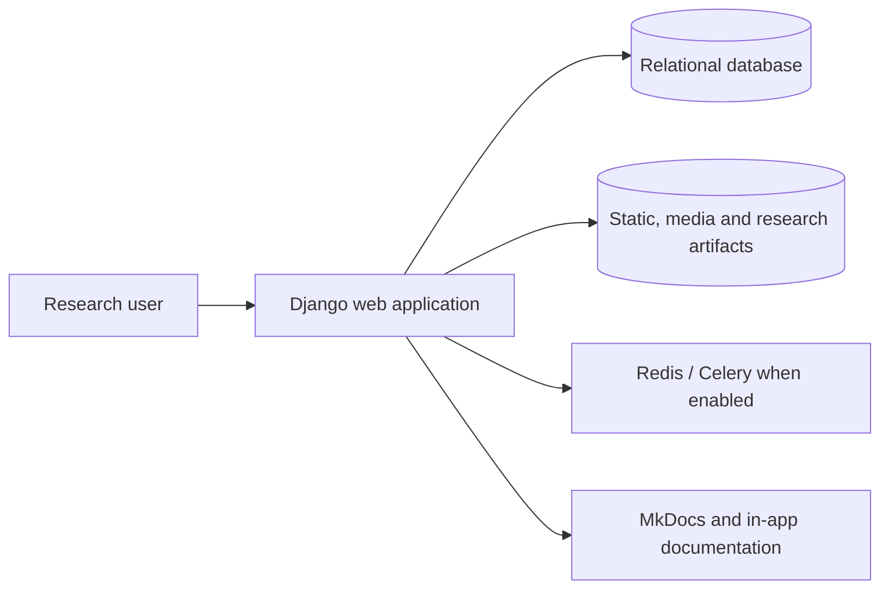
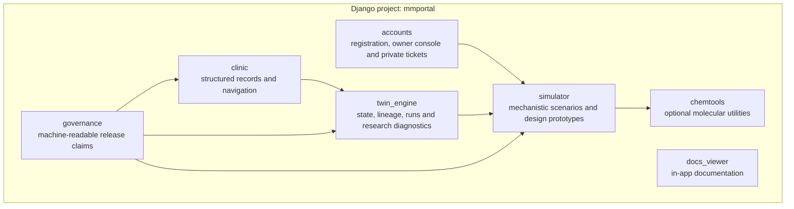
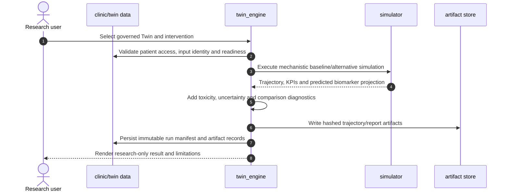
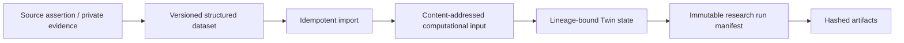

# Current system architecture

> **CURRENT architecture.** This page describes the existing application structure. The recorded audit SHA is a fixed evidence point, not a moving pointer to the deployed image. It is not the target virtual-laboratory architecture.

Source verification and deployment are separate. PR #86 was tested at
`49d1a89b12cd0508e8c6aba2340cb193a31eed11` and merged as the SHA above. Required
and post-merge CI, Pages and image publication passed. Its image index is
`sha256:0d707ef6c20ee3f6cc4650730610ee045af56955130ab28a5bb98b7bdccfc405`,
with matching OCI source and image environment. Target-image tests passed on
disposable SQLite/NFS. The controlled release Job passed backup restore,
preserved ACTIVE owner/MFA/gates, initialized the empty catalogue with one
synthetic scenario and verified static assets. Web and both workers report the
same source/digest with unchanged 1 CPU / 1 GiB ceilings; 20 public route/asset
probes passed. This was an **intermediate deployment**, because returning
browsers received stale unversioned CSS (14400-second cache lifetime) despite
correct collected files. PR #87 adds source-versioned asset URLs. Its acceptance
requires the corrected image's protected checks, rollout/readback and
returning-browser asset verification. The [release procedure](../operations/AUTHENTICATION_AND_ACCESS.md)
and **dated release-evidence comment in [GitHub #79](https://github.com/andreazedda/bmyCure4MM/issues/79)**
distinguish this historical result from the current deployed source/digest and
asset hashes, recorded only after observation. This page does not predict a
future build hash or claim an unobserved PR #87 merge/deployment.

## System context



The primary UI is server-rendered Django with incremental HTMX interactions. The verified 2026-11-06 cluster target also uses SQLite on an existing NFS data PVC. PostgreSQL is a separate target concern, not the deployed backend. Caddy routes the project host to web and the separate static service; media and static files have existing PVCs. Account notifications currently use a bounded minutely maintenance CronJob because broker delivery through the existing independent Redis endpoints is not yet proven. Web and existing Celery use the same digest-pinned image. See the [developer handbook](../development/DEVELOPMENT.md) for the current release boundary.

## Current application containers



## Bounded responsibilities

### `clinic`

- structured patient, assessment and treatment entities;
- patient list/detail and clinical-history surfaces;
- ownership fields and selected API filtering;
- legacy clinical authentication entry points;
- temporary governed smoke-user command.

Current limitation: object-level authorization is not yet consistently centralized across all web views and aggregate queries.

### `simulator`

- `MathematicalModel` ODE execution;
- scenario and `SimulationAttempt` workflows;
- PK/PD presets and time-resolved dose functions;
- model-relative KPI summaries;
- experimental therapy-design code.
- one controlled, idempotent empty-catalogue initializer using the existing
  `Scenario` model and shared policy lock; it creates no patient records,
  per-user sandbox or numerical parameter overrides and preserves existing
  inactive catalogues.

Current limitation: core biological parameters and several endpoint definitions are heuristic research abstractions.

### `twin_engine`

- persistent `PatientTwinState` and parent/child lineage;
- computational-input identity;
- longitudinal labs, interruptions and adverse events;
- observation model and residuals;
- calibration infrastructure;
- mechanistic counterfactual runs;
- uncertainty, sensitivity, robustness and backtesting prototypes;
- immutable run manifests, artifact hashes, comparability and invalidation;
- Simple Research View, Research Cockpit and Developer Console.

Current limitation: infrastructure does not establish identifiable or externally validated patient-specific prediction.

### `chemtools`

- optional RDKit-dependent and molecular-analysis utilities;
- asynchronous jobs where configured;
- generated artifacts.

Current limitation: molecular utilities are exploratory and are not evidence of anti-myeloma efficacy.

## Current scientific run flow



## Current data and identity flow



Private source documents and direct identifiers stay outside Git. The repository stores contracts and de-identified/synthetic material only.

## Current authentication boundary

```text
public: documentation, access requests, login and synthetic learning catalog
registered member: own existing learning attempts/exports and private tickets
owner with MFA: request review, account state/expiry, gates and ticket replies
clinical/research/admin: separate existing permissions, denied to new registrants
```

The `accounts` app extends the existing Django User. It does not replace the user model or make approved members staff. Verification, approval, activation and email delivery are separate states. Session version, current access and expiry are checked on protected requests. Object selectors scope saved learning attempts and exports to their author. Registered members, including a nonstaff owner, cannot discover or submit legacy patient assessments through the simulator form; clinical context retains its separate existing authorization boundary. Revocation is terminal and cannot be bypassed through suspension followed by renewal. Public documentation checks both the requested and symlink-resolved destination against its Markdown allowlist. See the [lifecycle and recovery contract](../operations/AUTHENTICATION_AND_ACCESS.md).

This delivery does not complete broad research RBAC issue #8 or the first external researcher pilot #78. No second demo portal, assigned scenario provisioning, compute worker or parallel quota system was introduced.

## Current deployment and CI boundary

- deterministic dependency lock exists;
- several GitHub Actions workflows exist;
- image-build and deployment automation exist;
- `.github/workflows/dependency-quality.yml` aggregates locked quality, core Python 3.11/3.12, frozen image and real registration-browser jobs into `required`; the protected release checks were verified before the recorded merge;
- production source/digest, actual SQLite/NFS storage, bounded account security and backup evidence are recorded in the access runbook; PostgreSQL migration, global compute admission/cancellation, comprehensive clinical RBAC and full disaster recovery remain separate M0-S work.

The PR #86 checks passed 473 local Django tests and two combined real-browser
tests in 38.646s, with no frozen scientific-baseline changes. The target image
passed 83 focused tests on disposable SQLite on the existing NFS PVC at the
unchanged 1 CPU / 512 MiB test ceiling. These are technical checks with synthetic
data and isolated email; they do not establish new email receipt or independent
maintainer/researcher acceptance. A rollback must keep additive schema and PVCs,
close requests/activations and suspend external members before reverting these
security fixes; matching old-image static assets need a separate collectstatic
Job, because the earlier image lacks the new catalogue command.

The [source/data atlas](../development/CODE_ATLAS.md) maps concrete functions, model fields, scientific kernel and failure domains. The [manual verification record](../development/AUDIT_VERIFICATION_2026_11_06.md) distinguishes current executed checks from historical release evidence and pending human acceptance.
