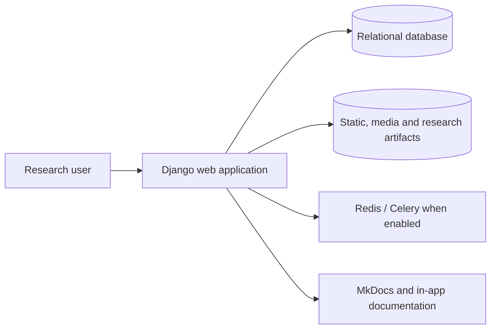
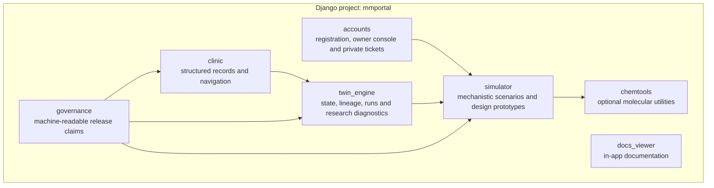
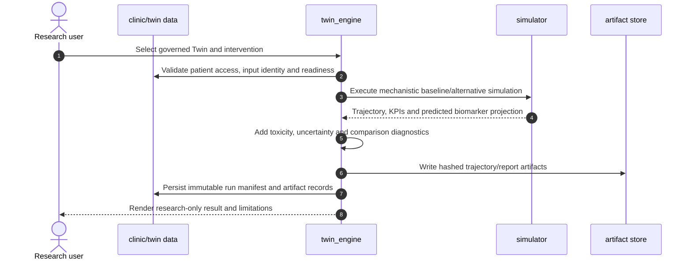
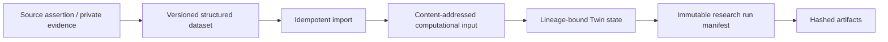

# Current system architecture

> **CURRENT architecture.** This page describes the repository at the verified SHA. It is not the target virtual-laboratory architecture.

## System context



The primary UI is server-rendered Django with incremental HTMX interactions. The verified 2026-11-06 cluster target also uses SQLite on an existing NFS data PVC. PostgreSQL is a separate target concern, not the deployed backend. Caddy routes the project host to web and the separate static service; media and static files have existing PVCs. Account notifications currently use a bounded minutely maintenance CronJob because broker delivery through the existing independent Redis endpoints is not yet proven. Web and existing Celery use the same digest-pinned image. See the [developer handbook](../development/DEVELOPMENT.md) for the current release boundary.

## Current application containers



## Bounded responsibilities

### `clinic`

- structured patient, assessment and treatment entities;
- patient list/detail and clinical-history surfaces;
- ownership fields and selected API filtering;
- legacy clinical authentication entry points;
- temporary governed smoke-user command.

Current limitation: object-level authorization is not yet consistently centralized across all web views and aggregate queries.

### `simulator`

- `MathematicalModel` ODE execution;
- scenario and `SimulationAttempt` workflows;
- PK/PD presets and time-resolved dose functions;
- model-relative KPI summaries;
- experimental therapy-design code.

Current limitation: core biological parameters and several endpoint definitions are heuristic research abstractions.

### `twin_engine`

- persistent `PatientTwinState` and parent/child lineage;
- computational-input identity;
- longitudinal labs, interruptions and adverse events;
- observation model and residuals;
- calibration infrastructure;
- mechanistic counterfactual runs;
- uncertainty, sensitivity, robustness and backtesting prototypes;
- immutable run manifests, artifact hashes, comparability and invalidation;
- Simple Research View, Research Cockpit and Developer Console.

Current limitation: infrastructure does not establish identifiable or externally validated patient-specific prediction.

### `chemtools`

- optional RDKit-dependent and molecular-analysis utilities;
- asynchronous jobs where configured;
- generated artifacts.

Current limitation: molecular utilities are exploratory and are not evidence of anti-myeloma efficacy.

## Current scientific run flow



## Current data and identity flow



Private source documents and direct identifiers stay outside Git. The repository stores contracts and de-identified/synthetic material only.

## Current authentication boundary

```text
public: documentation, access requests, login and synthetic learning catalog
registered member: own existing learning attempts/exports and private tickets
owner with MFA: request review, account state/expiry, gates and ticket replies
clinical/research/admin: separate existing permissions, denied to new registrants
```

The `accounts` app extends the existing Django User. It does not replace the user model or make approved members staff. Verification, approval, activation and email delivery are separate states. Session version, current access and expiry are checked on protected requests. Object selectors scope saved learning attempts and exports to their author. See the [lifecycle and recovery contract](../operations/AUTHENTICATION_AND_ACCESS.md).

This delivery does not complete broad research RBAC issue #8 or the first external researcher pilot #78. No second demo portal, assigned scenario provisioning, compute worker or parallel quota system was introduced.

## Current deployment and CI boundary

- deterministic dependency lock exists;
- several GitHub Actions workflows exist;
- image-build and deployment automation exist;
- branch-protected aggregate scientific CI is not yet verified;
- production security, PostgreSQL, storage, quotas, observability and recovery must be evidenced separately under M0-S.
