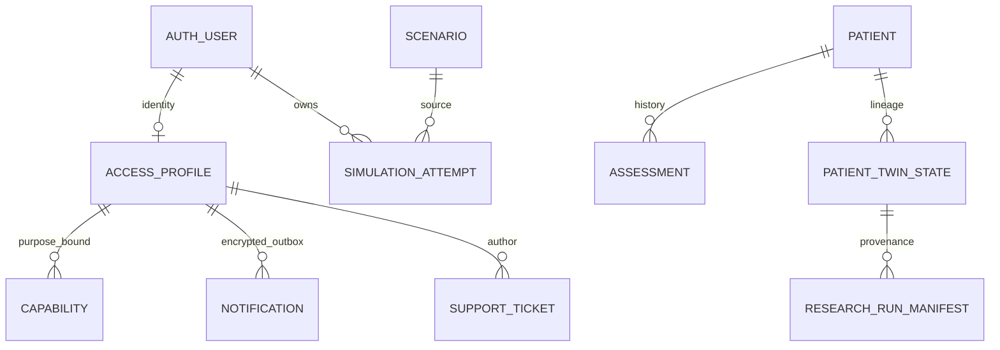
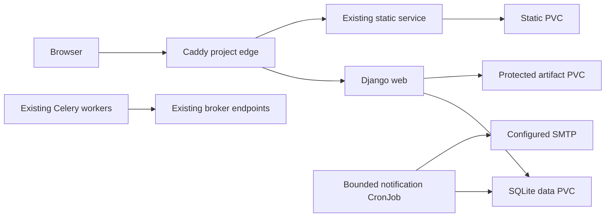

# Source, data and runtime atlas

This atlas answers **where a behavior starts, what it changes, how it fails and which check exercises it**. It complements the [handbook](DEVELOPMENT.md), [current architecture](../architecture/CURRENT_SYSTEM.md), [model registry](../models/REGISTRY.md) and [manual troubleshooting exercise](TROUBLESHOOTING.md). It is a source audit of the existing application, not a new application or evidence of clinical validity.

The immutable source anchors below refer to audit baseline `fa9c35473302debf3c9a289d5f34f0bc7f771dbd`. At audit entry, the deployed Python source was `abbb98f`; `fa9c354` added documentation only. A code checkout, an image digest and a runtime configuration are distinct identities. Consult the dated [release evidence](../operations/AUTHENTICATION_AND_ACCESS.md) for deployed versions after this baseline.

## Find a symbol without an assistant

The [machine-readable critical inventory](https://github.com/andreazedda/bmyCure4MM/blob/master/docs/development/SOURCE_INVENTORY.json) records **31 modules and 94 top-level symbols**, including exact signatures, source lines, class methods and declared Django model fields. These entries were parsed from the baseline Python AST; they contain no database records, credentials or patient data. The inventory covers the critical boundaries below, not every private helper or template.

```bash
# Find an implementation or caller in your current checkout.
rg -n 'def confirm_capability|confirm_capability\(' accounts
rg -n 'def export_attempt|attempt_export' simulator
rg -n 'def prepare_run_identity|prepare_run_identity\(' twin_engine
# Inspect a file without executing code or reading a database.
sed -n '257,309p' accounts/services.py
```

`uv run --frozen python -m scripts.check_developer_atlas` checks all inventoried paths and function signatures against the current checkout without opening a database. It does not claim to enumerate every helper or verify a scientific model.

Line numbers in a newer checkout can move; use symbol names and compare the linked commit before relying on a line breakpoint. Maintainers own this map collectively; scientific changes also require the model/claims review described in the [governance policy](../governance/CLAIMS_POLICY.md).

## Critical call and responsibility map

Each linked symbol opens the baseline source. Test paths below are executable labels or source files, not a claim of blanket coverage.

| Entry / implementation | Input → output | Side effects, rejection and boundary | Associated verification |
| --- | --- | --- | --- |
| `mmportal/urls.py`, `accounts/middleware.py` | Path + authenticated session → route/allow/deny | Registered community identities cannot enter clinical/research/admin routes; aliases matter | `accounts.tests.test_existing_site` |
| `normalize_email(value)` | ASCII email → trimmed lowercase identity | No provider-specific dot/plus removal; invalid identity rejected | `accounts.tests.test_lifecycle` |
| `locked_policy()` | Transaction context → singleton policy lock | A database write serializes SQLite mutations; backend failure must fail closed | `accounts.tests.test_concurrency` |
| `request_access(data)` | Validated request → pending profile or generic repeat result | Unique identity, verification capability/outbox; valid repeats do not rotate links; expired retry exposes no status session | `accounts.tests.test_lifecycle` |
| `confirm_capability(raw, purpose, password=None)` | Purpose-bound secret + optional password → transition | Consumes a hash-matched token once inside transaction; checks expiry/revocation/identity; GET alone has no effect | lifecycle tests; `accounts.tests.browser_journey` |
| `decide_request(actor, identity_id, *, approve, days=14)` | Approver + verified request + 1–14 days → approved/rejected profile | Approval creates a nonstaff identity and queues activation; no password chosen by approver | lifecycle and concurrency tests |
| `change_access(actor, identity_id, state)` | Privileged state transition → persisted access state | Invalidates product session version and capability eligibility; existing job cancellation is a separate limit | lifecycle tests |
| `VerifiedEmailBackend.authenticate(...)` | Verified email + password → User/None | Ordinary authentication; access state and role checks; no Django-admin login dependency | lifecycle/browser tests |
| `dispatch_notification()` / `housekeeping()` | Eligible encrypted outbox row → bounded delivery/retention update | Shared budgets, retries and expiry; provider acceptance cannot prove receipt; SMTP/commit crash can redeliver | lifecycle email-failure tests; runtime receipt evidence separate |
| `submit_feedback(identity, data, key)` | Active author + bounded text + idempotency UUID → ticket | Private author ownership; duplicate submission does not duplicate ticket | `accounts.tests.test_existing_site` |
| `ensure_learning_example` management command (audit correction) | Empty existing catalogue → one independent synthetic Scenario | Idempotent under the account policy lock; existing/inactive catalogue preserved; required after migrations when setting up an empty instance | `simulator.tests.test_learning_entry` |
| `Scenario`, `SimulationAttempt.run_model(self)` | Shared source scenario + private parameter dictionary → trajectory summaries/artifact locators | Resolves defaults/Twin choices and saves attempt outputs; scientific inputs unchanged by registration | `simulator.tests`; existing-site real-engine test |
| `SimulationAttempt._resolve_solver_inputs(cls, resolved_params)` | Form/JSON/sentinel values → numerical solver arguments | Invalid nonnumeric values raise `ValueError`; UI validators and this resolver are separate layers | `simulator.tests.test_parameter_validation` |
| `MathematicalModel.simulate(self)` | Dataclass state + PK/PD + schedule → pandas DataFrame | SciPy integration; invalid horizon/no drug or failed solver raises; no DB writes itself | `scripts.check_numerical_baseline`; manual kernel exercise below |
| `simulate_scenario(request, pk)` | Authorized POST + validated form → saved private attempt/result | Executes existing synchronous path; request failure and compute cancellation are not equivalent | existing-site engine/browser tests |
| `export_attempt(request, pk)` / `attempt_plot_embed(request, pk)` | Current authorized user + attempt ID → CSV/JSON/HTML response | Rechecks current access and ownership; resolves the file under MEDIA_ROOT; no public media fallback | cross-user, suspension and artifact tests in existing-site suite |
| `Patient`, `Assessment`, `PatientTherapy` | Structured clinical entities → persisted relational records | Private domain, distinct from account approval; no automatic clinical entitlement | `clinic.tests`; account-denial tests |
| `initialize_from_assessment(assessment, user=None)` | Validated assessment → lineage-bound `PatientTwinState` | Calling view validates patient access; service validates minimum data and creates current state; existing current/parent rules apply | `twin_engine.tests.test_services`, `test_models`, `test_migrations` |
| `build_solver_inputs_from_twin_state(...)` / `run_patient_simulation(...)` | State + schedule + horizon + overrides → solver inputs and simulation dictionary | Exposure conversion and observation projection; missing dosing/schedule warnings remain explicit | `test_services`, `test_exposure_bridge` |
| `calibrate_patient_parameters(...)` / `objective_function(...)` | State + history + bounds → candidate/calibration diagnostics | Optimizer attempts, residual records and identifiability limits; not clinical validation | `test_services`, `test_regressions` |
| `predict_biomarkers(...)` / `compute_residuals(...)` | Latent state / predicted vs observed values → modeled observation/residuals | A proxy-to-observation model; units/normalizers are part of the scientific contract | `test_services`, `test_regressions` |
| `prepare_run_identity(...)` / `verify_manifest_artifacts(manifest)` | State/input/version vector → identity; manifest → verification/exception | Dependency/schema/image hashes, content addressing and artifact integrity; missing lineage must not become an implicit real-data binding | `twin_engine.tests.test_run_manifests`, `test_input_contract` |
| `compare_manifests(...)` / `invalidate_manifest(...)` | Two manifests or invalidation reason → comparison/append-only invalidation | Version-vector rules and explicit policy; never edit a completed run to make it comparable | `test_run_manifests` |
| `run_counterfactual(...)` | Governed baseline/intervention → persisted research comparison | Research estimand and assumptions; no causal efficacy claim from numerical difference | `test_services`, `test_views` |
| `uncertainty`, `sensitivity`, `robustness`, `backtesting` modules | Declared seeds, perturbations/history → research diagnostic reports | Sampling cost and scope are separate from registration quotas; output is model-relative | Matching `twin_engine.tests.test_*` modules |
| `load_dataset_bundle(...)` / `import_dataset(...)` | Explicit governed dataset contract → validation/import plan | Identifier/schema/semantic/idempotence checks; not a public upload capability | `twin_engine.tests.test_research_dataset_import` |
| `ChemJob`, `_enqueue(...)`, `run_*_job(...)` | Validated molecular request → queued/running/result record | Optional RDKit, external lookups and existing broker; unavailable dependencies/network are failures/degraded evidence | `chemtools.tests` and dependency profiles; live broker not established by unit tests |
| `is_safe_path(path)` / `render_markdown(content, source_path)` | Allowed tracked Markdown → HTML/TOC | Resolved path allowlist, escaping/rendering and link rewriting; never arbitrary filesystem or media | `docs_viewer.tests` |

Exact function signatures and immutable clickable source anchors for every named implementation are in the inventory. Use the symbol directory below for the most frequent jumps:

| Module | Baseline source symbols |
| --- | --- |
| `accounts/services.py` | [normalize_email](https://github.com/andreazedda/bmyCure4MM/blob/fa9c35473302debf3c9a289d5f34f0bc7f771dbd/accounts/services.py#L32), [locked_policy](https://github.com/andreazedda/bmyCure4MM/blob/fa9c35473302debf3c9a289d5f34f0bc7f771dbd/accounts/services.py#L44), [request_access](https://github.com/andreazedda/bmyCure4MM/blob/fa9c35473302debf3c9a289d5f34f0bc7f771dbd/accounts/services.py#L151), [bootstrap_owner](https://github.com/andreazedda/bmyCure4MM/blob/fa9c35473302debf3c9a289d5f34f0bc7f771dbd/accounts/services.py#L197), [confirm_capability](https://github.com/andreazedda/bmyCure4MM/blob/fa9c35473302debf3c9a289d5f34f0bc7f771dbd/accounts/services.py#L257), [decide_request](https://github.com/andreazedda/bmyCure4MM/blob/fa9c35473302debf3c9a289d5f34f0bc7f771dbd/accounts/services.py#L310), [change_access](https://github.com/andreazedda/bmyCure4MM/blob/fa9c35473302debf3c9a289d5f34f0bc7f771dbd/accounts/services.py#L359), [rate_limit](https://github.com/andreazedda/bmyCure4MM/blob/fa9c35473302debf3c9a289d5f34f0bc7f771dbd/accounts/services.py#L421), [submit_feedback](https://github.com/andreazedda/bmyCure4MM/blob/fa9c35473302debf3c9a289d5f34f0bc7f771dbd/accounts/services.py#L444) |
| `accounts/backends.py` | [VerifiedEmailBackend](https://github.com/andreazedda/bmyCure4MM/blob/fa9c35473302debf3c9a289d5f34f0bc7f771dbd/accounts/backends.py#L8) |
| `accounts/middleware.py` | [ProductAccessMiddleware](https://github.com/andreazedda/bmyCure4MM/blob/fa9c35473302debf3c9a289d5f34f0bc7f771dbd/accounts/middleware.py#L10) |
| `accounts/notifications.py` | [dispatch_notification](https://github.com/andreazedda/bmyCure4MM/blob/fa9c35473302debf3c9a289d5f34f0bc7f771dbd/accounts/notifications.py#L26), [housekeeping](https://github.com/andreazedda/bmyCure4MM/blob/fa9c35473302debf3c9a289d5f34f0bc7f771dbd/accounts/notifications.py#L110) |
| `simulator/models.py` | [Scenario](https://github.com/andreazedda/bmyCure4MM/blob/fa9c35473302debf3c9a289d5f34f0bc7f771dbd/simulator/models.py#L48), [SimulationAttempt](https://github.com/andreazedda/bmyCure4MM/blob/fa9c35473302debf3c9a289d5f34f0bc7f771dbd/simulator/models.py#L287) |
| `simulator/models_simulation.py` | [MathematicalModel](https://github.com/andreazedda/bmyCure4MM/blob/fa9c35473302debf3c9a289d5f34f0bc7f771dbd/simulator/models_simulation.py#L12) |
| `simulator/views_manage.py` | [simulate_scenario](https://github.com/andreazedda/bmyCure4MM/blob/fa9c35473302debf3c9a289d5f34f0bc7f771dbd/simulator/views_manage.py#L316), [export_attempt](https://github.com/andreazedda/bmyCure4MM/blob/fa9c35473302debf3c9a289d5f34f0bc7f771dbd/simulator/views_manage.py#L424), [attempt_plot_embed](https://github.com/andreazedda/bmyCure4MM/blob/fa9c35473302debf3c9a289d5f34f0bc7f771dbd/simulator/views_manage.py#L454) |
| `simulator/pharmaco/registry.py` | [resolve](https://github.com/andreazedda/bmyCure4MM/blob/fa9c35473302debf3c9a289d5f34f0bc7f771dbd/simulator/pharmaco/registry.py#L16), [get_drug_profile](https://github.com/andreazedda/bmyCure4MM/blob/fa9c35473302debf3c9a289d5f34f0bc7f771dbd/simulator/pharmaco/registry.py#L48), [list_profiles](https://github.com/andreazedda/bmyCure4MM/blob/fa9c35473302debf3c9a289d5f34f0bc7f771dbd/simulator/pharmaco/registry.py#L54) |
| `clinic/models.py` | [Patient](https://github.com/andreazedda/bmyCure4MM/blob/fa9c35473302debf3c9a289d5f34f0bc7f771dbd/clinic/models.py#L8), [CytogeneticAbnormality](https://github.com/andreazedda/bmyCure4MM/blob/fa9c35473302debf3c9a289d5f34f0bc7f771dbd/clinic/models.py#L47), [PatientCytogenetics](https://github.com/andreazedda/bmyCure4MM/blob/fa9c35473302debf3c9a289d5f34f0bc7f771dbd/clinic/models.py#L60), [Assessment](https://github.com/andreazedda/bmyCure4MM/blob/fa9c35473302debf3c9a289d5f34f0bc7f771dbd/clinic/models.py#L80), [Regimen](https://github.com/andreazedda/bmyCure4MM/blob/fa9c35473302debf3c9a289d5f34f0bc7f771dbd/clinic/models.py#L123), [PatientTherapy](https://github.com/andreazedda/bmyCure4MM/blob/fa9c35473302debf3c9a289d5f34f0bc7f771dbd/clinic/models.py#L139) |
| `clinic/views.py` | [can_edit_patient](https://github.com/andreazedda/bmyCure4MM/blob/fa9c35473302debf3c9a289d5f34f0bc7f771dbd/clinic/views.py#L35), [patient_detail](https://github.com/andreazedda/bmyCure4MM/blob/fa9c35473302debf3c9a289d5f34f0bc7f771dbd/clinic/views.py#L164) |
| `clinic/api.py` | [PatientSerializer](https://github.com/andreazedda/bmyCure4MM/blob/fa9c35473302debf3c9a289d5f34f0bc7f771dbd/clinic/api.py#L9), [AssessmentSerializer](https://github.com/andreazedda/bmyCure4MM/blob/fa9c35473302debf3c9a289d5f34f0bc7f771dbd/clinic/api.py#L15), [PatientViewSet](https://github.com/andreazedda/bmyCure4MM/blob/fa9c35473302debf3c9a289d5f34f0bc7f771dbd/clinic/api.py#L21), [AssessmentViewSet](https://github.com/andreazedda/bmyCure4MM/blob/fa9c35473302debf3c9a289d5f34f0bc7f771dbd/clinic/api.py#L35) |
| `chemtools/models.py` | [ChemJob](https://github.com/andreazedda/bmyCure4MM/blob/fa9c35473302debf3c9a289d5f34f0bc7f771dbd/chemtools/models.py#L10) |
| `chemtools/views.py` | [_enqueue](https://github.com/andreazedda/bmyCure4MM/blob/fa9c35473302debf3c9a289d5f34f0bc7f771dbd/chemtools/views.py#L21), [job_status](https://github.com/andreazedda/bmyCure4MM/blob/fa9c35473302debf3c9a289d5f34f0bc7f771dbd/chemtools/views.py#L204), [job_detail](https://github.com/andreazedda/bmyCure4MM/blob/fa9c35473302debf3c9a289d5f34f0bc7f771dbd/chemtools/views.py#L226) |
| `chemtools/tasks.py` | [run_drug_params_job](https://github.com/andreazedda/bmyCure4MM/blob/fa9c35473302debf3c9a289d5f34f0bc7f771dbd/chemtools/tasks.py#L83), [run_binding_viz_job](https://github.com/andreazedda/bmyCure4MM/blob/fa9c35473302debf3c9a289d5f34f0bc7f771dbd/chemtools/tasks.py#L122), [run_similarity_job](https://github.com/andreazedda/bmyCure4MM/blob/fa9c35473302debf3c9a289d5f34f0bc7f771dbd/chemtools/tasks.py#L170) |
| `docs_viewer/views.py` | [docs_index](https://github.com/andreazedda/bmyCure4MM/blob/fa9c35473302debf3c9a289d5f34f0bc7f771dbd/docs_viewer/views.py#L25), [docs_view](https://github.com/andreazedda/bmyCure4MM/blob/fa9c35473302debf3c9a289d5f34f0bc7f771dbd/docs_viewer/views.py#L54), [docs_search](https://github.com/andreazedda/bmyCure4MM/blob/fa9c35473302debf3c9a289d5f34f0bc7f771dbd/docs_viewer/views.py#L144) |
| `docs_viewer/utils.py` | [is_safe_path](https://github.com/andreazedda/bmyCure4MM/blob/fa9c35473302debf3c9a289d5f34f0bc7f771dbd/docs_viewer/utils.py#L28), [DocumentationReferences](https://github.com/andreazedda/bmyCure4MM/blob/fa9c35473302debf3c9a289d5f34f0bc7f771dbd/docs_viewer/utils.py#L91), [render_markdown](https://github.com/andreazedda/bmyCure4MM/blob/fa9c35473302debf3c9a289d5f34f0bc7f771dbd/docs_viewer/utils.py#L124) |
| `twin_engine/models.py` | [PatientTwinState](https://github.com/andreazedda/bmyCure4MM/blob/fa9c35473302debf3c9a289d5f34f0bc7f771dbd/twin_engine/models.py#L22), [ObservationResidual](https://github.com/andreazedda/bmyCure4MM/blob/fa9c35473302debf3c9a289d5f34f0bc7f771dbd/twin_engine/models.py#L121), [LongitudinalLabResult](https://github.com/andreazedda/bmyCure4MM/blob/fa9c35473302debf3c9a289d5f34f0bc7f771dbd/twin_engine/models.py#L176), [TherapyInterruption](https://github.com/andreazedda/bmyCure4MM/blob/fa9c35473302debf3c9a289d5f34f0bc7f771dbd/twin_engine/models.py#L269), [AdverseEvent](https://github.com/andreazedda/bmyCure4MM/blob/fa9c35473302debf3c9a289d5f34f0bc7f771dbd/twin_engine/models.py#L326), [CounterfactualRun](https://github.com/andreazedda/bmyCure4MM/blob/fa9c35473302debf3c9a289d5f34f0bc7f771dbd/twin_engine/models.py#L381), [CausalAssumptionSet](https://github.com/andreazedda/bmyCure4MM/blob/fa9c35473302debf3c9a289d5f34f0bc7f771dbd/twin_engine/models.py#L495), [ResearchRunManifest](https://github.com/andreazedda/bmyCure4MM/blob/fa9c35473302debf3c9a289d5f34f0bc7f771dbd/twin_engine/models.py#L544), [ResearchRunInvalidation](https://github.com/andreazedda/bmyCure4MM/blob/fa9c35473302debf3c9a289d5f34f0bc7f771dbd/twin_engine/models.py#L627), [SimulationRunMetadata](https://github.com/andreazedda/bmyCure4MM/blob/fa9c35473302debf3c9a289d5f34f0bc7f771dbd/twin_engine/models.py#L675) |
| `accounts/models.py` | [AccessPolicy](https://github.com/andreazedda/bmyCure4MM/blob/fa9c35473302debf3c9a289d5f34f0bc7f771dbd/accounts/models.py#L10), [AccessProfile](https://github.com/andreazedda/bmyCure4MM/blob/fa9c35473302debf3c9a289d5f34f0bc7f771dbd/accounts/models.py#L20), [Capability](https://github.com/andreazedda/bmyCure4MM/blob/fa9c35473302debf3c9a289d5f34f0bc7f771dbd/accounts/models.py#L70), [Notification](https://github.com/andreazedda/bmyCure4MM/blob/fa9c35473302debf3c9a289d5f34f0bc7f771dbd/accounts/models.py#L86), [AuditEvent](https://github.com/andreazedda/bmyCure4MM/blob/fa9c35473302debf3c9a289d5f34f0bc7f771dbd/accounts/models.py#L105), [RateBucket](https://github.com/andreazedda/bmyCure4MM/blob/fa9c35473302debf3c9a289d5f34f0bc7f771dbd/accounts/models.py#L115), [SupportTicket](https://github.com/andreazedda/bmyCure4MM/blob/fa9c35473302debf3c9a289d5f34f0bc7f771dbd/accounts/models.py#L121) |
| `twin_engine/state_model.py` | [initialize_from_assessment](https://github.com/andreazedda/bmyCure4MM/blob/fa9c35473302debf3c9a289d5f34f0bc7f771dbd/twin_engine/state_model.py#L14), [get_current_twin_state](https://github.com/andreazedda/bmyCure4MM/blob/fa9c35473302debf3c9a289d5f34f0bc7f771dbd/twin_engine/state_model.py#L89), [set_current_state](https://github.com/andreazedda/bmyCure4MM/blob/fa9c35473302debf3c9a289d5f34f0bc7f771dbd/twin_engine/state_model.py#L93) |
| `twin_engine/simulation_bridge.py` | [build_solver_inputs_from_twin_state](https://github.com/andreazedda/bmyCure4MM/blob/fa9c35473302debf3c9a289d5f34f0bc7f771dbd/twin_engine/simulation_bridge.py#L16), [run_patient_simulation](https://github.com/andreazedda/bmyCure4MM/blob/fa9c35473302debf3c9a289d5f34f0bc7f771dbd/twin_engine/simulation_bridge.py#L76) |
| `twin_engine/calibration.py` | [calibrate_patient_parameters](https://github.com/andreazedda/bmyCure4MM/blob/fa9c35473302debf3c9a289d5f34f0bc7f771dbd/twin_engine/calibration.py#L32), [objective_function](https://github.com/andreazedda/bmyCure4MM/blob/fa9c35473302debf3c9a289d5f34f0bc7f771dbd/twin_engine/calibration.py#L194) |
| `twin_engine/observation_model.py` | [predict_biomarkers](https://github.com/andreazedda/bmyCure4MM/blob/fa9c35473302debf3c9a289d5f34f0bc7f771dbd/twin_engine/observation_model.py#L41), [compute_residuals](https://github.com/andreazedda/bmyCure4MM/blob/fa9c35473302debf3c9a289d5f34f0bc7f771dbd/twin_engine/observation_model.py#L134) |
| `twin_engine/run_manifest.py` | [current_git_sha](https://github.com/andreazedda/bmyCure4MM/blob/fa9c35473302debf3c9a289d5f34f0bc7f771dbd/twin_engine/run_manifest.py#L68), [container_digest](https://github.com/andreazedda/bmyCure4MM/blob/fa9c35473302debf3c9a289d5f34f0bc7f771dbd/twin_engine/run_manifest.py#L95), [prepare_run_identity](https://github.com/andreazedda/bmyCure4MM/blob/fa9c35473302debf3c9a289d5f34f0bc7f771dbd/twin_engine/run_manifest.py#L126), [verify_manifest_artifacts](https://github.com/andreazedda/bmyCure4MM/blob/fa9c35473302debf3c9a289d5f34f0bc7f771dbd/twin_engine/run_manifest.py#L264) |
| `twin_engine/comparability.py` | [compare_manifests](https://github.com/andreazedda/bmyCure4MM/blob/fa9c35473302debf3c9a289d5f34f0bc7f771dbd/twin_engine/comparability.py#L27), [invalidate_manifest](https://github.com/andreazedda/bmyCure4MM/blob/fa9c35473302debf3c9a289d5f34f0bc7f771dbd/twin_engine/comparability.py#L94) |
| `twin_engine/validators.py` | [validate_no_direct_identifier_in_artifact_payload](https://github.com/andreazedda/bmyCure4MM/blob/fa9c35473302debf3c9a289d5f34f0bc7f771dbd/twin_engine/validators.py#L37), [validate_patient_access](https://github.com/andreazedda/bmyCure4MM/blob/fa9c35473302debf3c9a289d5f34f0bc7f771dbd/twin_engine/validators.py#L61) |
| `twin_engine/research_dataset_import.py` | [load_dataset_bundle](https://github.com/andreazedda/bmyCure4MM/blob/fa9c35473302debf3c9a289d5f34f0bc7f771dbd/twin_engine/research_dataset_import.py#L239), [import_dataset](https://github.com/andreazedda/bmyCure4MM/blob/fa9c35473302debf3c9a289d5f34f0bc7f771dbd/twin_engine/research_dataset_import.py#L724) |
| `twin_engine/counterfactual.py` | [run_counterfactual](https://github.com/andreazedda/bmyCure4MM/blob/fa9c35473302debf3c9a289d5f34f0bc7f771dbd/twin_engine/counterfactual.py#L27) |
| `twin_engine/uncertainty.py` | [UncertaintyConfig](https://github.com/andreazedda/bmyCure4MM/blob/fa9c35473302debf3c9a289d5f34f0bc7f771dbd/twin_engine/uncertainty.py#L29), [build_parameter_uncertainty_space](https://github.com/andreazedda/bmyCure4MM/blob/fa9c35473302debf3c9a289d5f34f0bc7f771dbd/twin_engine/uncertainty.py#L38), [sample_parameter_sets](https://github.com/andreazedda/bmyCure4MM/blob/fa9c35473302debf3c9a289d5f34f0bc7f771dbd/twin_engine/uncertainty.py#L75), [summarize_distribution](https://github.com/andreazedda/bmyCure4MM/blob/fa9c35473302debf3c9a289d5f34f0bc7f771dbd/twin_engine/uncertainty.py#L121), [compute_interval](https://github.com/andreazedda/bmyCure4MM/blob/fa9c35473302debf3c9a289d5f34f0bc7f771dbd/twin_engine/uncertainty.py#L143), [classify_uncertainty_width](https://github.com/andreazedda/bmyCure4MM/blob/fa9c35473302debf3c9a289d5f34f0bc7f771dbd/twin_engine/uncertainty.py#L164), [run_counterfactual_uncertainty](https://github.com/andreazedda/bmyCure4MM/blob/fa9c35473302debf3c9a289d5f34f0bc7f771dbd/twin_engine/uncertainty.py#L178) |
| `twin_engine/sensitivity.py` | [run_counterfactual_sensitivity](https://github.com/andreazedda/bmyCure4MM/blob/fa9c35473302debf3c9a289d5f34f0bc7f771dbd/twin_engine/sensitivity.py#L17) |
| `twin_engine/robustness.py` | [compute_robust_scenario_ranking](https://github.com/andreazedda/bmyCure4MM/blob/fa9c35473302debf3c9a289d5f34f0bc7f771dbd/twin_engine/robustness.py#L10) |
| `twin_engine/backtesting.py` | [run_patient_backtest](https://github.com/andreazedda/bmyCure4MM/blob/fa9c35473302debf3c9a289d5f34f0bc7f771dbd/twin_engine/backtesting.py#L30) |

The audit also adds viewer helpers `document_metadata`, `document_language` and `repository_source_url` in `docs_viewer/utils.py`: they expose document freshness/language and safe source links. These are corrections after the pinned baseline, so their current implementation and tests are reviewed in the audit PR rather than linked to nonexistent baseline anchors.

## Data model and storage boundaries



This is a conceptual relationship map, not a claim that every lineage link is a database foreign key. Consult the declared fields in the inventory and the canonical contracts for JSON lineage.

| Object group | Persistent contract | Validation / immutability / retention |
| --- | --- | --- |
| AccessProfile | UUID, normalized unique email, optional OneToOne User, independent request/access states, expiry, session version | DB normalized-email constraint and one-owner condition; services own transitions; no duplicate-email account merge |
| Capability / Notification | Hashed purpose token / separately encrypted outbox payload, independent delivery state, unique deduplication key | One-use POST, 24h verification or 2h activation/reset; queued sensitive payload retention bounded by housekeeping |
| SupportTicket | Author FK, category, message/reply ≤2000 chars, internal note ≤1000, submission UUID | Per-author queries and owner console; internal notes excluded from member output |
| Scenario / SimulationAttempt | Shared scenario parameters; user-owned attempt parameters/results/summary/artifacts JSON | Editing a run does not mutate the shared example; artifacts require current authorization |
| Patient / Assessment / therapy | Relational clinical ownership, measurements, longitudinal therapy links | Approved curiosity account has no access; no real-data fixtures or public imports in this workflow |
| PatientTwinState | State vector, parameters, uncertainty, parent/current lineage and computational input binding | Schema and scientific contract validators on save; [lineage contract](../research/TWIN_LINEAGE.md) |
| ResearchRunManifest / SimulationRunMetadata / CounterfactualRun | Completed run/version identities, immutable report/artifact metadata | Model save/delete guards and artifact hashes; [manifest contract](../research/RUN_MANIFESTS.md) |
| ResearchRunInvalidation | Append-only invalidation reason and provenance | Preserve prior result identity; [comparability rules](../research/COMPARABILITY_AND_INVALIDATION.md) |

Actual runtime mounts are `/data/db.sqlite3`, `/app/media` and `/app/staticfiles` on existing NFS PVCs. These roles are separate even when backed by the same storage system. A stored MEDIA_URL-shaped locator is **not an authorization grant or a public download URL**. Export/embed views resolve it under the configured media root after checking ownership and current account state. Documentation uses only tracked public figures collected into static output.

Do not cache rendered pages across authenticated identities. Use current selectors for listings, aggregate counts and downloads, not only a detail-view check. The broader clinical RBAC backlog remains distinct from the community-denial boundary verified by account tests.

## What the numerical kernel actually computes

For each drug index, the current kernel defines the effect and interaction as:

$$
e_i = E_{\max,i}\frac{\max(C_i,0)}{EC_{50,i}+\max(C_i,0)+10^{-9}},\qquad
\tilde{\mathbf e}=\operatorname{clip}(\mathbf e+M\mathbf e,0,1).
$$

With nonnegative state values used in the right-hand side:

$$
\frac{dT}{dt}=r_TT\left(1-\frac{T}{\max(K_T,10^{-6})}\right)-T\sum_i\tilde e_i,
$$

$$
\frac{dH}{dt}=r_HH\left(1-\frac{H}{\max(K_H,10^{-6})}\right)
-\max(q,0.1)H\operatorname{mean}_i(\tilde e_i),
\qquad \frac{dC_i}{dt}=-k_iC_i+u_i(t).
$$

| Symbol / implementation | Unit or interpretation | Current implementation detail |
| --- | --- | --- |
| `t`, `time_span` | days | `end > start`; evenly spaced output grid, default 200 points |
| `T`, `H` | cell-count proxies | Defaults resolved by the caller; carrying capacities default to 10× tumor and 1.2× healthy baseline in the kernel |
| `r_T`, `r_H` | inverse days | `growth_rates['tumor']` / `['healthy']` |
| `half_life` | hours | Converted to days before `log(2)/half_life_days`; explicit `k_elim` overrides |
| `C_i`, `Vd`, `EC50`, `Emax` | internal PK/PD scales | Initial concentration is numeric dose divided by `max(Vd, 1e-6)`; the implementation is a research abstraction, not a validated clinical dose conversion |
| `u_i(t)` | model input per day | Nonnegative schedule function, otherwise nonnegative numeric dose divided by horizon; no additional Vd conversion in the RHS |
| `M` | dimensionless interaction matrix | Learning caller uses diagonal strength; shape mismatch in the kernel falls back to zero matrix |
| `q` | immune-compromise multiplier | Lower bound 0.1 in RHS; not a clinical toxicity grade |

`solve_ivp` uses its default method (RK45), `rtol=1e-6`, `atol=1e-8`, non-vectorized RHS and the requested output grid. `evaluation_points` sets saved sampling points, **not the adaptive integrator step size**. A negative output cannot be declared impossible merely because the RHS clamps its arguments. Input validation, numerical stability and scientific validity are different checks.

The [manual kernel exercise](TROUBLESHOOTING.md#reproduce-a-numerical-failure-and-recover) compares a zero-effect trajectory with the analytic logistic solution, then deliberately requests an invalid horizon. The [governed numerical baseline](../research/NUMERICAL_REPRODUCIBILITY.md) additionally checks recorded outputs and seeded reports. Neither validates efficacy, prognosis, clinical calibration or a real patient.

## Architecture, failure domains and maintenance triggers



- A healthy HTML response does not prove CSS/JS availability, worker execution or mail receipt.
- NFS latency affects DB locks, artifacts and collectstatic; static and DB checks must both pass before a release is accepted.
- API/etcd instability affects scheduling and rollout evidence even while an existing web pod serves traffic.
- A queued outbox message is independent of account activation. A provider-accepted message is independent of recipient receipt.
- The existing Redis topology is not validated by the minutely account CronJob; do not infer broker reliability from successful account email.

Refresh this atlas when routes, authorization, model fields/migrations, scientific defaults/solver, artifact resolution, dependency lock, worker dispatch or deployment topology change. Regenerate/review source anchors and run the relevant checks; do not merely change the verified date. Preserve the previous release identity in the release ledger. Independent maintainer acceptance in #79 is a human gate, distinct from the automated/manual-command evidence collected here.
