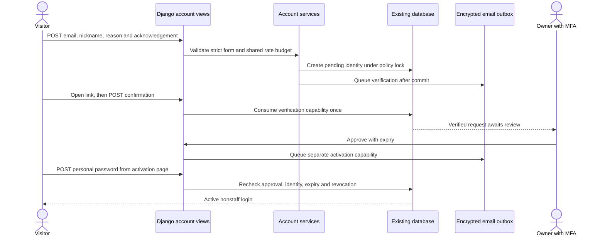
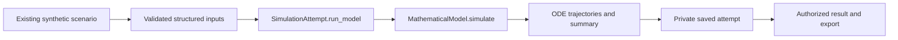
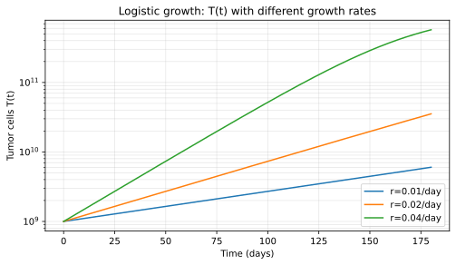

# Developer handbook

This is the entry point for working on the **existing bmyCure4MM application**. It connects setup, code, equations, permissions and release operations. The platform remains an **E1 research prototype**; software tests do not establish scientific or clinical validity.

!!! tip "Choose your starting point"
    **Using the platform:** follow the [access and first-use guide](../operations/AUTHENTICATION_AND_ACCESS.md#short-user-guide).

    **Changing the code:** start with the disposable environment below, then use the [source/data atlas](CODE_ATLAS.md), two traced workflows and [manual diagnosis exercises](TROUBLESHOOTING.md).

    **Understanding the model:** open the [runtime equations and illustrated explanation](../guides/mathematical_models_en.md), [model registry](../models/REGISTRY.md) and [run-manifest contract](../research/RUN_MANIFESTS.md).

## Reproduce a safe development environment

Use Python 3.11 or 3.12 and the checked-in `uv.lock`. Work with an empty local database and synthetic inputs. Never point tests at production PVCs, a restored clinical database or private media.

```bash
uv sync --frozen --extra chemistry
export DJANGO_SETTINGS_MODULE=mmportal.settings_test
export DJANGO_DEBUG=1
export DJANGO_SECURE_SSL_REDIRECT=0
unset BMY_TEST_DATABASE_NAME
export BMY_TEST_ROOT="$(mktemp -d /tmp/bmy-development.XXXXXX)"
uv run python manage.py migrate --noinput
uv run python manage.py ensure_learning_example
uv run python manage.py runserver 127.0.0.1:8001
```

`mmportal.settings_test` redirects database, test database, media, logs and static output into `BMY_TEST_ROOT`. It uses a local in-memory email backend and reduced password hashing for isolated verification. **Never deploy this settings module.** An empty isolated database intentionally has no patients or default user. `ensure_learning_example` adds one independently synthetic learning example only when the existing Scenario catalogue is empty; it does not overwrite or reactivate existing scenarios. The local in-memory mail backend does not expose manual activation links. For a complete reproducible onboarding/learning walkthrough, use the dedicated SMTP-sink browser command below: its temporary fixture is created independently and requires no external mailbox or credentials.

The optional `chemistry` extra installs RDKit for molecular workflows. Core checks can run without it. See [dependency profiles](../operations/DEPENDENCIES.md) rather than installing unpinned packages to fix an import.

There is no default password. Ordinary users request access and choose their own password after approval. Owner bootstrap consumes secret-backed configuration; see [bootstrap and recovery](../operations/AUTHENTICATION_AND_ACCESS.md#bootstrap-recovery-and-restore). Do not make a curious user staff to bypass login.

### Optional background services

The web application, Celery and Redis are existing components. In separate terminals for an isolated development instance:

```bash
redis-server --bind 127.0.0.1
uv run celery -A mmportal worker --pool=solo --loglevel=info
```

Start only services you own. Stop them through their own terminal or service manager. Synchronous eager tasks are a test convenience and do not demonstrate safe production scheduling. The basic learning simulation still follows its existing execution path; this access release does not introduce a second simulation worker or a new global compute budget.

## Code atlas

For exact signatures, clickable source anchors, model fields, failure modes and test mapping, open the [source/data/runtime atlas](CODE_ATLAS.md). The table below is the orientation map.

| Area | Entry points | Reads and writes | Boundary |
| --- | --- | --- | --- |
| Project and routing | `mmportal/settings.py`, `mmportal/urls.py` | Runtime configuration; app URLs and middleware | Production secrets stay outside Git |
| Account lifecycle | `accounts/views.py`, `accounts/services.py`, `accounts/models.py` | Existing Django User plus AccessProfile, Capability, AuditEvent and AccessPolicy | Approval and activation are distinct; public fields cannot promote roles |
| Authentication | `accounts/backends.py`, `accounts/middleware.py`, `accounts/permissions.py` | Verified email, expiry, access state and session version | Nonstaff member; protected clinical/research surfaces denied |
| Email | `accounts/notifications.py`, `accounts/emails.py`, email templates | Encrypted outbox, deduplication key, delivery attempts | Backend acceptance is not proof of receipt |
| Private feedback | Account views and SupportTicket | Author, category, bounded text, reply and internal note | Only author and authorized approver; internal notes are never public |
| Learning simulation | `simulator/views.py`, `simulator/models.py` | Scenario and private SimulationAttempt | Shared source scenario; saved attempts and exports are scoped to the user |
| Numerical runtime | `simulator/models_simulation.py`, `simulator/pharmaco/registry.py` | Resolved inputs, PK/PD and trajectories | Preserve equations, units and scientific versioning |
| Twin research | `twin_engine/` | Twin state, lineage, immutable manifest and artifacts | Existing governed research workflow, not registration permission |
| Clinical records | `clinic/` | Patient, assessment and treatment records | Registration grants no clinical access |
| Molecular tools | `chemtools/` | Optional RDKit workflows and generated artifacts | Not granted by community registration |
| Documentation | `docs_viewer/views.py`, `docs_viewer/utils.py`, `docs/`, `mkdocs.yml` | Whitelisted Markdown; public tracked figures and renderer assets | No arbitrary file or private media serving |

The [current architecture](../architecture/CURRENT_SYSTEM.md) and [target architecture](../architecture/TARGET_VIRTUAL_LAB.md) remain separate. Browse detailed [database objects](../reference/database_objects.md), [endpoints](../reference/endpoints.md) and [configuration](../reference/configuration.md); historical pages must not override current code or runtime evidence.

## Trace 1: request → verified email → approved account



### Read the implementation

1. `RequestForm` in `accounts/forms.py` rejects unexpected privilege or scope keys. `normalize_email` in `accounts/services.py` trims and lowercases without removing dots or plus suffixes.
2. `request_access` and `locked_policy` in `accounts/services.py` serialize lifecycle mutations. SQLite needs a write before `select_for_update`; assuming PostgreSQL row locks on SQLite would be incorrect.
3. `issue_capability` stores a digest for validation and queues an encrypted email payload. Verification, owner activation, member activation and reset have distinct purposes.
4. Account views accept confirmation by **POST**, never merely by GET. A fragment is moved into a hidden form field and removed from browser history by `accounts/static/accounts/access.js`.
5. Approval and activation stay separate transactions. `VerifiedEmailBackend` and middleware recheck access at login and on subsequent requests. Password reset cannot restore revoked access.
6. The owner's console uses TOTP with a locally generated QR. New member accounts have neither staff nor superuser privileges.

### Reproduce a failure safely

Run the lifecycle tests below. They deliberately reuse tokens, submit the owner's identity through the public form, inject privilege fields, reset revoked accounts and exercise concurrent transitions. The expected result is rejection without duplicate users or notifications. Inspect assertions and sanitized audit codes, never print the token or password to diagnose a failure.

```bash
BMY_TEST_ROOT="$(mktemp -d /tmp/bmy-lifecycle.XXXXXX)" \
DJANGO_SETTINGS_MODULE=mmportal.settings_test \
uv run python manage.py test accounts.tests --noinput
```

## Trace 2: learning input → real calculation → private result



`SimulationAttempt.run_model` in `simulator/models.py` resolves model inputs, applies PK/PD schedules, calls the runtime in `simulator/models_simulation.py`, then derives trajectory summaries and artifacts. The scenario is a starting point; changing inputs must not mutate the shared example. Follow result/export selectors in `simulator/views_manage.py` and the cross-user checks in `accounts/tests/test_existing_site.py`.

The model documentation explains the existing tumor equation:

$$
\frac{dT}{dt} = r_T \, T \left(1 - \frac{T}{K_T}\right) - \Big(\sum_i E_i(C_i)\Big)\,T
$$

Here `t` is in days, `T` is tumor burden or its model proxy, `r_T` is a growth rate and `K_T` is carrying capacity. Drug-effect functions depend on the documented PK/PD assumptions. This formula is explanatory documentation of the existing runtime, not a new calibration or a clinically validated prediction.



Continue with the [full equations, units and implementation mapping](../guides/mathematical_models_en.md), [simulator parameters](../reference/simulator_parameters.md), [comparability rules](../research/COMPARABILITY_AND_INVALIDATION.md) and [numerical reproducibility](../research/NUMERICAL_REPRODUCIBILITY.md). The chart is a tracked illustrative figure; it is not a production run or patient-derived evidence.

## Verification commands and what they prove

```bash
uv lock --check
uv run ruff check .
uv run ruff format --check .
uv run mypy
uv run python -m scripts.check_repository_hygiene
uv run python -m scripts.check_developer_atlas
uv run python -m scripts.check_numerical_baseline
uv run python -m scripts.audit_dependencies
DJANGO_SETTINGS_MODULE=mmportal.settings_test uv run python manage.py check
DJANGO_SETTINGS_MODULE=mmportal.settings_test uv run python manage.py makemigrations --check --dry-run
DJANGO_SETTINGS_MODULE=mmportal.settings_test uv run python manage.py test --noinput
uv run --frozen --no-default-groups --group docs mkdocs build --strict
```

For real browser forms, CSRF, two independent users, owner TOTP, private ticket replies and a local SMTP sink:

```bash
uv sync --frozen --group screenshots
uv run --frozen --group screenshots playwright install chromium
DJANGO_SETTINGS_MODULE=mmportal.settings_test \
BMY_TEST_ROOT="$(mktemp -d /tmp/bmy-browser.XXXXXX)" \
uv run --frozen --group screenshots python manage.py test accounts.tests.browser_journey docs_viewer.tests.browser_audit --noinput
```

| Evidence | Proves | Does not prove |
| --- | --- | --- |
| Unit/integration tests | Tested contracts on the declared backend | Production rollout or email receipt |
| Browser journey with sink | Real forms, authentication and ownership on synthetic data | Human usability acceptance or mailbox delivery |
| Numerical baseline | No change to recorded solver output | Scientific validation |
| Production smoke | Routes, assets, source identity and runtime metadata | Full clinical authorization audit |
| Owner login and MFA | Owner can enter the product console | First external researcher acceptance |

Do not update golden numerical output to conceal a regression. A reported skip, unavailable backend or inaccessible production page remains a limitation. The [source/data/runtime atlas](CODE_ATLAS.md) and [executed audit record](AUDIT_VERIFICATION_2026_11_06.md) now provide the implementation map and manual commands. Issue #79 still requires independent human maintainer acceptance; an automated command run cannot satisfy that human gate.

## Actual runtime and release operations

At the verified 2026-11-06 target, `bmycure4mm.clusterlab.uk` routes through the project's Caddy edge to Django. Database, media and static files use separate existing NFS PVC mounts. **The deployed database is SQLite**, not an assumed PostgreSQL instance. Web and the existing Celery deployment use the same immutable GHCR image digest and explicit source SHA. Startup migration/collectstatic flags are disabled; controlled release Jobs perform those operations.

Account notification delivery currently uses the bounded minutely maintenance CronJob. It sends at most five messages per run, applies shared attempt budgets and performs account expiry/retention. It is not a simulation worker. The existing two independent Redis endpoints need separate reliability work before assuming broker-backed account dispatch.

Use the [authentication/email/deploy/recovery runbook](../operations/AUTHENTICATION_AND_ACCESS.md) for operator steps, rollback and restored-token quarantine. Before deployment verify target, namespace, recoverable backup, current digests and existing owner state. Preserve the owner's selected gates and credentials on routine releases. There is no schema downgrade in application rollback.

!!! warning "Release boundaries"
    Do not enable clinical imports, widen permissions, change other services' routing or increase compute budgets to make a test pass. Registration is permission to try the allowed existing learning workflow and send private feedback. Global compute admission, cancellation and full research RBAC remain separately governed work.
